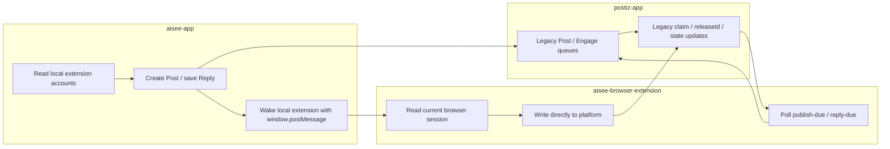
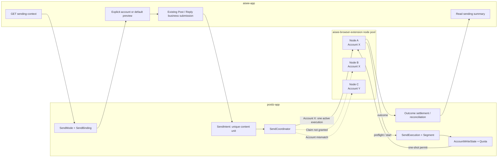
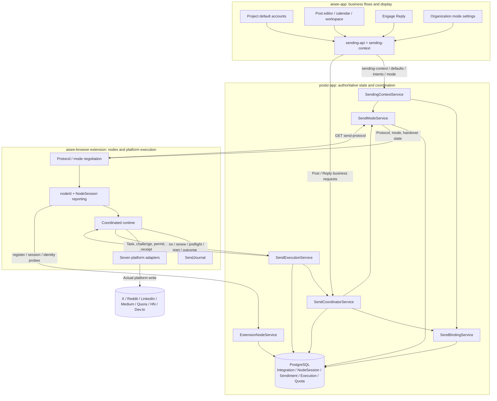
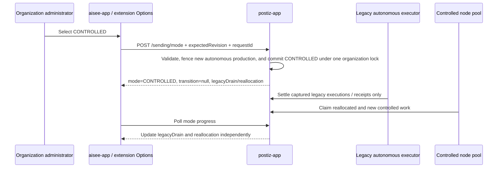
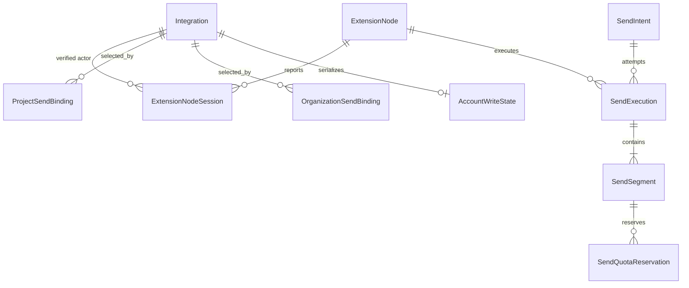
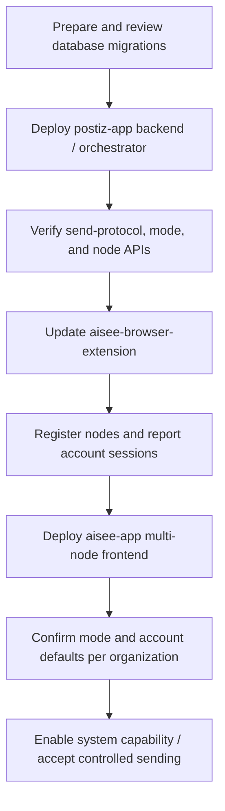

# Single-node and Multi-node Sending Upgrade Overview

Updated: 2026-10-23.

Based on the [account, content uniqueness, and extension node binding design](project-account-extension-node-binding-design.md), this document compares the runtime models, call relationships, and code responsibilities before and after the upgrade across `postiz-app`, `aisee-browser-extension`, and `aisee-app`.

“Single-node” here means that the previous business flow treated the current browser extension as the executor for a send. It does not mean that only one extension could be installed. Multiple browser instances could exist, but they lacked unified account-level node coordination, one-shot submission permits, and content uniqueness protection across executors.

Repository-specific comparisons:

- `postiz-app`: Section 8 of this document.
- [`aisee-browser-extension` before-and-after comparison](../../aisee-browser-extension/docs/multi-node-sending-before-after.md).
- [`aisee-app` before-and-after comparison](../../aisee-app/docs/multi-node-sending-before-after.md).

## 1. Upgrade Summary

Before the upgrade, the Web app, current browser extension, and legacy backend Post/Reply queues formed a local-browser-oriented sending chain. The page or extension selected an account from the current session, the extension claimed organization-scoped tasks and called the platform directly, and the backend primarily recorded outcomes through Post/Reply states and legacy leases.

After the upgrade, the business account, execution node, and right to send content are separate objects:

- `Integration` represents a specific sending account on a platform.
- `ExtensionNode` / `ExtensionNodeSession` represent a browser profile and its currently verifiable account sessions.
- `SendIntent` represents the unique right to send a business content unit. Changing the account, node, or execution path does not create another sending opportunity.

`aisee-app` handles business choices and status display. `postiz-app` handles account resolution, queuing, node matching, permits, quotas, and settlement. `aisee-browser-extension` proves the current account identity and performs one authorized platform write.

## 2. Overall Before-and-After Comparison

| Dimension | Before: local extension / logical single node | After: account binding / multi-node coordination |
| --- | --- | --- |
| Executor selection | The extension in the current browser or the browser that polled the task | The backend atomically grants a claim to a verified node matching the account |
| Account source | Current extension session, page-local selection, and legacy Integration configuration | Explicit account → Project default → Organization default; only OPTIONAL permits first-node binding to the current actor |
| Accounts and nodes | Closely coupled in the business flow | The account is the business identity; the node is the execution location. One account can have multiple nodes |
| Task uniqueness | Post/Reply states, legacy claims, and caller discipline | A SendIntent unique on `(organizationId, contentUnitId)`, shared across accounts, nodes, and channels |
| Claim and permission | Claiming from the legacy queue allowed an attempt to call the platform | Claim only reserves execution ownership; each segment still needs preflight and a one-shot start permit |
| Concurrency control | Legacy leases mainly protected individual records | SendIntent CAS, one active execution, AccountWriteState, and quota reservations work together |
| Outcome model | Success/failure callbacks update business state | CONFIRMED / NOT_SUBMITTED / UNKNOWN segment facts are separate from SUCCEEDED / FAILED_FINAL / RECONCILING execution states |
| Timeout meaning | Lease expiry could allow another claim | Lease expiry does not prove non-submission; authorized or uncertain work requires reconciliation rather than automatic resend |
| Post/Reply consistency | Separate claim and outcome paths evolved independently | Shared SendIntent, account locks, quotas, node protocol, and outcome services |
| Organization mode | No organization-level sending ownership state | Organizations configure AUTONOMOUS / CONTROLLED; the backend can derive an effective PAUSED state to govern new work |
| Mode changes | Starting and stopping legacy executors mainly depended on deployment procedures | Mode changes commit immediately; legacyDrain/controlledDrain independently settle prior work |
| Unstarted tasks | Could remain in the old pool or be recreated | Original IDs, content, accounts, and schedules are preserved during controlled allocation or safe handover |
| Autonomous browser writes | The browser could call the platform directly | New clients first register a browser-write receipt, execute once after admission, and settle the outcome |
| Frontend status | Pages interpreted Post.state, Reply status, and extension feedback independently | The backend returns a unified `sending` summary and `allowedActions` |
| Observability | Legacy API logs and business states were scattered | Requests, executions, segments, events, quotas, account locks, and node sessions form a traceable chain |

## 3. Runtime Model Before the Upgrade



The previous model centered on the current browser: the account displayed by the page, the account signed into the extension, and the task's execution location usually shared one context. With several browsers online, the backend lacked unified account-session facts for choosing a node. If a platform request had already been sent but its callback was lost, a legacy lease alone could not establish whether retrying was safe.

## 4. Runtime Model After the Upgrade



### Core Invariants

1. Each business content unit has one SendIntent. The account, node, Project, and execution channel are excluded from its unique key.
2. The account must belong to the same Organization and have valid Project and POST/REPLY authorization.
3. Claim is not permission to write to the platform. Only the first PENDING → AUTHORIZED transition for each segment returns a short-lived permit.
4. Any CONFIRMED or UNKNOWN fact prevents resending the same content as a new task.
5. An offline node affects availability, not the frozen account, and does not trigger fallback to another account.
6. Mode changes do not delete tasks, clear uncertain outcomes, reset quotas, or transfer old executions to new nodes.

## 5. Calls Across the Three Repositories



### Primary Call Ownership

| Call | Caller | Receiver | Purpose |
| --- | --- | --- | --- |
| `GET /projects/:projectId/sending-context` | aisee-app | postiz-app | Retrieve mode, accounts, defaults, node projections, and preselection requirements in one request |
| `POST /projects/:projectId/sending-accounts/save` | aisee-app | postiz-app | Save Project defaults for POST/REPLY |
| Existing `POST /posts`, schedule, and send-now | aisee-app | postiz-app | Create or schedule business content; controlled paths connect to SendIntent |
| `POST /sending/intents/reply` | aisee-app | postiz-app | Idempotently enqueue the original draft identified by `sentReplyId` |
| `GET/POST /sending/mode` | aisee-app and extension Options | postiz-app | Read or change the organization's sending mode |
| `GET /extension/send-protocol` | Extension | postiz-app | Negotiate mode, protocol, owner, and capabilities without granting write permission |
| `/extension/nodes/*` | Extension | postiz-app | Register nodes, verify credentials, read node status, and obtain identity-probe work |
| `POST /integrations/extension-session` | Extension | postiz-app | Report canonical account evidence for the current node and update NodeSession |
| `/extension/send-attempts/*` | Extension | postiz-app | Claim, renew, preflight, start, outcome, and stop-confirmation |
| `/sending/mode/browser-writes/*` | Extension autonomous path | postiz-app | One-shot admission and outcome receipts for autonomous writes |
| Business detail/status APIs | aisee-app | postiz-app | Return `sending` summaries and `allowedActions` without node credentials |

`aisee-app` does not call node execution APIs, and the extension does not replace Web flows for changing Project defaults. Both clients can read organization mode, but mutations remain subject to each interface's authorization scope.

## 6. Complete Controlled Sending Sequence

```mermaid
sequenceDiagram
  actor User as User
  participant Web as aisee-app
  participant API as postiz-app
  participant DB as PostgreSQL
  participant ExtA as Extension node A
  participant ExtB as Extension node B
  participant Platform as Social platform

  User->>Web: Create Post / send saved Reply
  Web->>API: GET sending-context
  API->>DB: Read mode, accounts, defaults, NodeSession
  API-->>Web: Candidate accounts and effective defaults
  Web->>API: Submit original business record / sentReplyId
  API->>DB: Resolve and freeze account; create or reuse SendIntent
  API-->>Web: QUEUED + sending summary

  par Competing nodes
    ExtA->>API: claim(node A, verified actor X)
    ExtB->>API: claim(node B, verified actor X)
  end
  API->>DB: CAS RESERVED + active execution
  API-->>ExtA: execution + lease
  API-->>ExtB: No task / claim not granted

  ExtA->>API: Segment preflight
  API->>DB: Revalidate mode, account, session, locks, quota
  API-->>ExtA: Identity challenge
  ExtA->>Platform: Read current actor without writing
  ExtA->>API: Report fresh account evidence
  ExtA->>API: Segment start
  API->>DB: AUTHORIZED + quota HELD
  API-->>ExtA: Short-lived one-shot permit
  ExtA->>ExtA: Persist AUTHORIZED and SUBMITTING
  ExtA->>Platform: Perform one platform write
  ExtA->>ExtA: Persist result / stop proof
  ExtA->>API: outcome(eventId, result/evidence)
  API->>DB: Idempotently settle segment, execution, quota, account lock
  API-->>ExtA: Receipt
  Web->>API: Read original business status
  API-->>Web: SUCCEEDED / RECONCILING / FAILED + allowedActions
```

## 7. Organization Modes and Transition Sequences

### Configured Modes and Effective State

Organization administrators can save only AUTONOMOUS or CONTROLLED. PAUSED is an effective runtime state derived from the configured mode, system capability, historical controlled facts, and safety conditions. Read APIs can return PAUSED; save APIs cannot accept it as a target mode.

| Mode | Ownership of new work | Prior work still allowed |
| --- | --- | --- |
| AUTONOMOUS | Existing autonomous business flows; actual browser writes first request browser-write admission | Original controlled executions in controlledDrain continue settlement under their existing execution ownership |
| CONTROLLED | Backend SendIntent and matching-node protocol | Original autonomous work in legacyDrain continues settlement and does not enter the new controlled claim pool |
| PAUSED | All new sends, controlled permits, and autonomous browser-write admissions are blocked | Reads, recovery, outcome reports, stop proofs, and late settlement remain available |

### Autonomous → Controlled



### Controlled → Autonomous

The mode likewise commits AUTONOMOUS immediately. Executions already claimed, started, or UNKNOWN remain in `controlledDrain`. Only unstarted tasks with a definite account that can be preserved move to the autonomous path. New autonomous writes use independent browser-write receipts and cannot reuse controlled permits.

## 8. postiz-app Before-and-After Comparison

### 8.1 Responsibility Changes

| Area | Before | After |
| --- | --- | --- |
| Data model | Primarily Integration, IntegrationProject, Post, EngageSentReply, and legacy claim fields | Coordination facts include Node, NodeSession, Organization/ProjectSendBinding, SendIntent, SendExecution, Segment, AccountWriteState, Quota, and MutationReceipt |
| Account uniqueness | Integration relied on historical fields, with potential confusion between display data and execution identity | Canonical identity uses organization + provider + namespace + normalized platform ID; profile data is auxiliary |
| Default accounts | Automation/page-local configuration with scattered POST/REPLY semantics | Independent Organization and Project defaults per platform/action; unified EXPLICIT → PROJECT → ORGANIZATION resolution |
| Post/Reply enqueue | Business services wrote QUEUE directly or dispatched through legacy extension/API paths | All controlled entry points freeze business content and account selection, then create or reuse SendIntent |
| Nodes | The backend did not know which specific extension nodes could use an account | ExtensionNode registration and NodeSession record each node's actor, verification status, and revision |
| Scheduling | Legacy publish-due/reply-due claims | SendCoordinator allocates by account, schedule, mode, locks, and capabilities; legacy paths are isolated |
| Execution | releaseId/claimedAt and business state carried much of the execution meaning | Independent SendExecution moves RESERVED → SENDING → terminal state; each segment retains permit and platform facts |
| Account exclusion | No unified write lock across Post/Reply/Project | AccountWriteState serializes writes to the same account across Projects, Post/Reply, nodes, and execution channels |
| Quota | Business paths checked their own local limits | SendQuotaBucket/Reservation atomically track HELD/COMMITTED/RELEASED and incorporate historical facts |
| Uncertain outcomes | Legacy failure or lease expiry could lead back to business retry | UNKNOWN enters RECONCILING, retains content/account protection, and requires evidence-based settlement |
| Mode governance | Environment switches or deployment conventions | Separate system capability, Organization mode, and REQUIRED/OPTIONAL policy |
| Frontend aggregation | Pages combined several account/settings APIs | SendingContextService returns the mode, candidates, defaults, and node projections in one response |

### 8.2 Main Code Locations

| Layer | Main files/directories | Responsibility |
| --- | --- | --- |
| API | `apps/backend/src/api/routes/sending-context.controller.ts` | Aggregated Project sending-context entry point |
| API | `sending-accounts.controller.ts` | Read and save Organization/Project account defaults |
| API | `send-executions.controller.ts` | Intents, node execution protocol, reconciliation, and protocol negotiation |
| API | `send-mode.controller.ts` | Organization mode, browser-write admission, and historical investigation |
| Service | `libraries/nestjs-libraries/src/extension/send-binding.service.ts` | Two-level defaults, account permissions, and explicit/inherited resolution |
| Service | `send-coordinator.service.ts` | SendIntent, enqueue, claim coordination, and outcome state |
| Service | `send-execution.service.ts` | Node authentication, leases, and segment preflight/start/outcome |
| Service | `extension-node.service.ts` | Node registration, credentials, NodeSession, and account evidence |
| Service | `send-mode.service.ts`, `send-mode-handover.ts` | Mode state machine, immediate changes, drain, reallocation, and receipts |
| Service | `send-quota.service.ts`, `send-preflight.ts` | Account locks, quota reservations, and final submission authorization |
| Business | `posts.service.ts`, `engage.service.ts`, automatic producers | Existing business entry points connect to shared SendIntent coordination |
| Data | `schema.prisma`, `migrations/add-*send*.sql`, `add-extension-nodes.sql` | Persist nodes, bindings, intents, executions, quotas, and audit facts |

### 8.3 Data Relationships



`Post.state` remains a business compatibility projection, but is no longer the sole authority for controlled sending. Whether a task can be claimed, started, retried, or reconciled depends on the combined SendIntent, active execution, segments, account locks, quota, and mode state.

## 9. Deployment Order and Runtime Boundaries



Boundaries and operational notes:

- Migration files in the repository do not mean they have been applied to the database. Only the user or deployment pipeline may apply them.
- Deploy the backend protocol before updating the extension. Missing capabilities in an older backend response do not authorize the extension to infer permission.
- `aisee-app` can retain AUTONOMOUS compatibility entry points, while actual browser writes remain protected by admission through the upgraded backend.
- Enabling the system capability does not automatically change an Organization to CONTROLLED; its mode must be explicitly saved.
- New controlled sends execute only through the standalone extension. OAuth connections retain identity/credential compatibility without gaining new platform-write capability in this release.
- Stop or upgrade old clients' local queues before switching when the server cannot fully observe them. The system cannot retrospectively guarantee that they stopped writing.
- Current code and test coverage do not constitute live-platform acceptance. All seven platforms still require validation against real accounts, page versions, and permissions.

## 10. Integration Checklist

| Check | Passing condition |
| --- | --- |
| Project context | aisee-app receives mode, accounts, defaults, and nodes in one request without assembling account sources itself |
| Node competition | Concurrent claims for the same content create only one active execution |
| Account matching | A node whose actual actor differs from the frozen integration cannot obtain a permit |
| Content uniqueness | Account, node, publishing-method changes, and retries reuse the original SendIntent |
| Crash recovery | Network loss or restart after a platform call preserves the journal; recovery replays the outcome without resubmitting to the platform |
| UNKNOWN | The Web app displays a pending-reconciliation state, while the backend retains account/content protection and issues no automatic new authorization |
| Mode changes | The new mode takes effect immediately; drain and reallocation progress are independent, and historical tasks are preserved |
| Identity changes | Organization/user changes invalidate Web caches and extension node sessions; old credentials cannot cross scopes |
| System pause | New tasks and permits stop; late outcomes and recovery queries can still settle existing work |
| Quota | Each platform write settles once; autonomous, controlled, and historically confirmed facts contribute to the same effective baseline |
