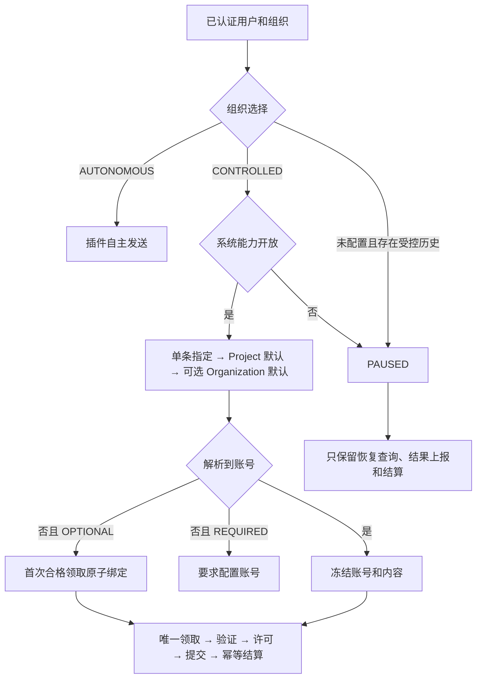

# Organization 发送模式

更新：2026-10-20。本文定义本次实现的模式、切换安全边界和 API。它取代旧设计中“环境变量开启后所有组织统一受控”的规则。两种模式均使用最新版插件。

## 产品行为

| 模式 | 用户体验 | 账号来源 |
| --- | --- | --- |
| AUTONOMOUS：插件自主发送 | 保留已有插件发送流程，不要求节点注册或受控许可 | 当前浏览器实际登录的账号；已有业务账号选择和校验继续适用 |
| CONTROLLED：多节点受控发送 | 后台冻结账号，由合格节点领取并验证，取得许可后提交 | 单条 Post/Reply 指定 → Project 默认 → 可选 Organization 全局默认 |
| PAUSED：受控发送暂停 | 停止新的受控发送，保留查询、结果上报和结算 | 保留已冻结账号和执行记录，不能退回自主流程重发 |

发送模式属于 **Organization**。同一组织的所有项目共用模式，Project 只管理平台/动作的默认账号。组织全局默认独立且可选，没有设置时解析结束于 Project。Post/Reply 不需要新增“继承默认”选项，未指定账号即由后台解析。

AUTONOMOUS 保留插件原有本地队列和业务租约，不使用 V1 的统一发送许可和受控提交日志。因此不能把自主模式宣传为具备与受控模式相同的多节点防重保证。已经领取或形成执行的受控任务不能转入自主队列重发；从未执行的任务只能通过明确交接转入。

默认未启用受控模式的组织使用 AUTONOMOUS。存在历史受控记录但没有显式模式的组织保守暂停，管理员需明确选择模式；不会因为本次升级自动释放历史保护。

REQUIRED / OPTIONAL 是 CONTROLLED 内部的账号预选政策：REQUIRED 要求入队前有账号；OPTIONAL 允许符合条件的无账号任务在首次领取时绑定。两者都必须经过节点认证、身份验证、账号锁和配额结算，都不是自主发送的开关。

## 用户实际操作

1. 只需要当前浏览器账号发送：未启用受控的新组织无需设置，保留 AUTONOMOUS。
2. 需要多节点：系统管理员先开放系统能力；组织管理员在最新版插件 Options 的 Organization sending mode 中选择 **Use controlled sending**。
3. 插件自动使用已有 Node ID 注册并上报当前平台账号。Options 的 **Check / retry node registration** 显示 HTTP 状态和错误码；失败时排查该错误，不自动转自主发送。
4. 设置 Project 默认账号，或在单条 Post/Reply 指定账号。Organization 全局默认可不设置。REQUIRED 下没有可解析账号会要求补选；OPTIONAL 下可等待首次合格领取绑定。
5. 需要退回自主发送：由管理员点击 **Use autonomous sending**，再查看 `controlledDrain` 的收尾进度和问题。不能安全交接的任务继续保留保护；不通过关闭系统能力强行降级。

aisee-app 的 Organization 模式入口和业务页面接入仍需前端按文档实现；本次已提供后端 API 和插件 Options 入口。

## 系统能力与组织选择

系统设置 `sending.account_bound_enabled` 只控制是否开放受控能力：

1. 环境变量 `ACCOUNT_BOUND_SENDING_ENABLED=false` 是紧急停止覆盖，Settings 不能绕过。
2. 存在有效的系统 Settings 时采用其 `enabled`。
3. 没有该设置时，以环境变量 `ACCOUNT_BOUND_SENDING_ENABLED=true` 为兼容默认；未设置时为 false。

系统开启不代表所有组织启用。系统关闭时，自主组织仍走自主流程；已选择 CONTROLLED 的组织进入 PAUSED，不自动降级。环境变量修改需要重启相关进程；Settings 保存后由后台读取，不依赖进程内永久缓存。



## 安全切换

模式切换是管理员操作，不由“项目没配置账号”、注册失败、网络错误或节点离线触发。

模式变更、任务入队、节点领取与提交授权共享组织模式事务锁，并使用现有 Serializable 重试机制。系统能力修改与授权共享系统设置锁。读取模式之后再在另一个事务无条件授权，不能满足并发保护要求。

模式修订也参与受控配额桶标识。自主期间可能产生新的 PUBLISHED 记录，重新开启受控时必须重新建立同一时间窗的配额基线，同时计入此前受控确认记录、自主发送记录和仍需保护的历史预留。切换模式、反复保存同一模式都不会重置当天额度；历史预留仍按原账本幂等结算。自主发送若没有可确认的账号归属，其已发送记录会保守计入相同平台的账号配额，不能把身份不明确当作零用量。

没有独立 Post 记录的线程补尾、自动评论/转发等自主写入，按一次性执行回执计入账号额度，以确认时间归属时间窗。只有已核实行为的提供方方法才记录确定的写入类型和数量；无法确认实际写入量的方法，或缺少可信确认时间的旧回执，会返回 `SEND_QUOTA_BASELINE_UNRESOLVED`，暂停该账号的新受控授权，避免将未知用量当作零。已有 PUBLISHED Post 的主帖和普通评论不重复计入回执用量。

| 方向 | 必须满足的条件 |
| --- | --- |
| 自主 → 受控 | 身份、修订和系统能力校验通过后立即生效；旧自主任务以 legacyDrain 独立收尾，未开始的队列按原账号和日期分配受控执行。 |
| 受控 → 自主 | 身份和修订校验通过后立即生效；从未执行且账号明确的队列转交自主，旧受控执行及未知结果通过 controlledDrain 独立收尾。 |
| 系统关闭 | 已受控组织暂停新工作；允许迟到结果继续结算，不清理未知结果或账号锁。 |

新模式与任务收尾独立提交。旧后台可能仍返回 HTTP 409 `SEND_MODE_SWITCH_UNSAFE`；新后台不再要求等完整组织队列结束才能反向切换。系统不取消已领取任务、不清锁、不退款、不复制任务，也不声称超时意味着平台没有提交。

### 队列和正在发送的帖子

- **AUTONOMOUS → CONTROLLED**：尚未开始的旧 `QUEUE` 帖子进入重新分配流程，按原账号和日期转入受控发送。已经开始的帖子、存在自主发送凭证的工作，以及已开始 thread 的相关段落保留原执行路径，通过 `legacyDrain` 收尾或等待结果核实。重新分配可能因账号、项目或绑定等问题受阻；通过 `GET /sending/mode` 的 `reallocation.remainingCount`、`blockedCount` 和 `issues` 查看进度及原因。
- **CONTROLLED → AUTONOMOUS**：没有执行历史、账号信息完整且满足安全交接条件的草稿和队列帖子转入自主路径；原 Intent 标记为 `HANDED_OVER`，Post 保留账号、内容和日期。已有执行历史的任务保留原受控路径。无法安全交接的任务继续受保护，原因见 `controlledDrain.issues`；例如插件发送的 LinkedIn 公司账号队列暂不支持交接。

插件的发送如果已取得后端许可，模式切换不会主动中断该次发送；插件继续执行并上报结果。反向切换后，插件会恢复本地保存的受控执行记录和待上报结果；收尾期间不领取全新的普通受控任务，未完成的领取请求可按原请求恢复。如果切换先于发送许可发生，新的发送可能被拒绝或延后，实际结果以准入和授权检查为准。

平台请求发出后若插件、网络或平台响应中断，结果可能为 `UNKNOWN`。不能仅凭异常或超时判断未发送，也不能直接重发；先停止原执行器并核查平台事实，再通过已有对账流程处理。

安全退回自主模式只影响后续自主业务。原受控内容的 Intent、提交日志、平台结果和配额流水永久保留；不能通过旧回调、变更账号、改写 Post 或重新排队绕过原内容保护。UNKNOWN 必须核查并走已有对账，不可当失败重发。

已经标记为 V1、尚未形成 Intent 的未提交草稿可交接到自主流程。队列只有能保留明确原账号且不存在领取/发送事实时才交接；其余保留原记录并在 controlledDrain.issues 说明原因，不能直接修改数据库抹掉保护。

自主流程中的历史 OAuth 自动转发、内部插件动作和线程补尾同样可能写入社交账号。它们在平台调用前使用现有 SendMutationReceipt 登记一次性执行权，与组织切换共享模式锁；平台调用在事务外执行，不放进会重试的数据库事务。确认结果回写回执，崩溃、异常或结果不明保留阻塞。相同业务动作的重试不会再次调用平台。此处复用回执表，不新增表。

插件接收到明确、匹配当前用户/组织的 AUTONOMOUS 授权后，才可进入自主流程。旧协议、请求失败或缺少字段不能解除本机的受控保护；本地尚有受控执行日志时，先恢复/上报，不能将其转入自主队列。

历史自主动作结果不明时，由组织管理员先停止原执行器、确认没有尚待提交的请求，再核查平台事实。专用查询/人工核查接口位于 `/sending/mode/autonomous-effects`；人工结论只解除切换阻塞，不重新授予同一动作发送权。NOT_SUBMITTED 也不自动重试。人工确认依赖操作人员提供真实证据，系统不能通过等待超时证明平台没有提交。

## 组织 API

沿用现有鉴权和 Organization 上下文，不能通过请求体指定其他组织。

```http
GET /sending/mode
```

返回模式状态、当前修订、系统能力和是否允许自主发送。`canManage` 用于前端显隐；服务端仍独立校验保存权限。最终字段以实现返回为准。

```json
{
  "organizationId": "organization-id",
  "userId": "current-user-id",
  "mode": "AUTONOMOUS",
  "configuredMode": null,
  "revision": 0,
  "systemEnabled": true,
  "systemRevision": 1,
  "autonomousAllowed": true,
  "canManage": true,
  "blockers": {
    "legacyQueuedPosts": 0, "legacyReplyDrafts": 0, "legacyClaims": 0,
    "controlledPendingPosts": 0, "nonterminalIntents": 0, "activeExecutions": 0,
    "uncertainSegments": 0, "heldQuotaReservations": 0, "accountLocks": 0,
    "autonomousEffects": 0
  }
}
```

```http
POST /sending/mode
Content-Type: application/json
```

```json
{
  "mode": "CONTROLLED",
  "expectedOrganizationId": "organization-id",
  "expectedUserId": "current-user-id",
  "expectedRevision": 0,
  "requestId": "one-stable-id-for-this-switch"
}
```

仅当前组织的有效 ADMIN/SUPERADMIN 可修改。一次操作固定 requestId 和请求体，网络重试复用；改变选择应新建 requestId。expectedRevision、expectedOrganizationId 和 expectedUserId 来自 GET；身份/组织变化返回 SEND_OWNER_CHANGED，版本过期则刷新并让用户重新决定，不能自动覆盖。这里版本保护的是整个组织的发送安全状态，不是普通默认账号表单。

相同 requestId 的重试读取已有回执；不同内容复用 requestId 被拒绝。模式版本冲突、权限不足、系统能力未开放和切换阻塞均应展示实际错误，不把失败展示为切换成功。

保存回执描述该次操作当时的结果。成功后必须重新 GET 当前模式，不能用旧回执覆盖后续修改。切换组织/用户后丢弃旧表单；不自动将旧操作重试到新身份。

### 历史自主平台写入的人工核查

```http
GET /sending/mode/autonomous-effects
POST /sending/mode/autonomous-effects/:id/resolve
```

仅当前组织 ADMIN/SUPERADMIN 可用。查询返回 `{ organizationId, userId, items }`，每项包含回执 id、动作、integrationId、状态、版本和创建时间及允许公开的业务资源标识；不返回凭据、请求原文或内部哈希。一次最多列出 100 项，处理后再次查询。

```json
{
  "decision": "NOT_SUBMITTED",
  "expectedRevision": 2,
  "expectedOrganizationId": "organization-id",
  "expectedUserId": "current-user-id",
  "requestId": "stable-resolution-id",
  "executorStopped": true,
  "noPendingSubmit": true,
  "evidence": "Stopped the original worker and checked the platform record."
}
```

decision 只允许 CONFIRMED / NOT_SUBMITTED。必须实际停止原执行器并核查平台事实，再提交真实证据（非空，最多 2000 字符）；这些字段是操作人员的确认，不是系统自动证明。处理使用版本 CAS 和幂等回执，不清除审计历史。NOT_SUBMITTED 不授权自动重试；人工 CONFIRMED 若没有原调用缓存结果，也不会重新调用平台“补结果”。业务 Post 状态和配额仍走各自既有结算入口，不由该接口猜测或直接修改。

历史服务端 OAuth 平台写入若抛出异常（包括 refresh_token 错误），保守进入 UNKNOWN。一次调用可能已完成部分提交，不能仅凭异常自动刷新令牌后重发整个动作；应先重新授权并核查结果。最新版插件的自主执行路径不经过这层 OAuth 包装。

## 系统管理 API

系统管理员使用专用类型校验接口，普通 Settings 写入不能绕过安全规则：

```http
GET /admin/settings/sending.account_bound_enabled
POST /admin/settings/sending.account_bound_enabled
```

```json
{
  "enabled": true,
  "expectedRevision": 0,
  "requestId": "one-stable-system-setting-id"
}
```

GET/保存返回 `{ key, value: { enabled, revision }, effectiveEnabled, environmentOverride }`，`environmentOverride="DISABLED"` 表示环境变量强制关闭。支持保留的 PUT 别名。环境变量强制 false 时返回的有效能力仍为关闭；不能仅凭存储值展示“受控已可用”。

## 插件和前端接入

`GET /extension/send-protocol` 保留原协议字段，增加组织模式投影：`sendingMode`、`modeRevision`、`autonomousAllowed`。自主模式返回 LEGACY 协议，表示调用现有自主执行路径，不表示使用旧版插件。暂停状态不能作为允许自主发送的信号。

Project/Post/Reply 继续使用 `GET /projects/:projectId/sending-context` 获取模式、默认账号与节点列表。读取失败必须显示错误。aisee-app 在 Organization 设置提供两个模式选择；无需新增个人开关或 Project 模式开关。默认账号、账号列表和 Reply 选择的详细改动见 [前端接入指南](../../aisee-app/docs/aisee-app-multi-node-integration.md)。

诊断按钮使用带 `x-extension-node-id`、`x-extension-node-token` 和 `x-extension-protocol-version: ACCOUNT_BOUND_V1` 的 `GET /extension/nodes/current` 核验当前凭据；返回仅含 `nodeId`、`organizationId`、`registeredByUserId`、`status`。该接口不重建或轮换凭据，不受注册回执十分钟恢复期限影响；撤销节点、错误凭据或身份归属不符不能显示注册成功。

插件 Options 显示当前组织模式及注册诊断。诊断仅包含 HTTP 状态和允许公开的错误码，不能展示 nodeToken、JWT、请求头或密钥。切换后重新读取后台模式，不能仅通过本地开关改变发送行为。

## 部署和验收

复用 Settings、SendMutationReceipt 和现有发送/配额记录，本次模式配置不新增表。已有受控发送依赖的迁移仍由用户或部署流水线应用；本次不连接数据库、不执行 SQL。

本版本的模式判定需要检查既有发送、执行、回执和配额表，因此部署前必须具备这些表，即使组织保留自主模式也一样。缺表或读取失败会报错，不推测为“从未受控”并放行发送。

部署后构建并重启 backend 和 orchestrator，更新独立插件。Settings 不会替代插件所需的稳定凭据密钥。先确认组织模式，再开启受控能力并清理切换阻塞。旧浏览器插件本地自主队列无法由服务器完全观测，升级前需停止旧执行并结清；不应混跑可绕过新授权的旧程序。

必须验证：默认自主、显式受控、系统暂停、权限和组织隔离、模式写入幂等、并发切换/领取/授权、迟到回调、UNKNOWN 不重发、配额只结算一次、本机日志恢复，以及注册失败不降级。

本次验证结果、逐项测试对应和未覆盖的真实环境边界见 [验收记录](../planning/organization-sending-modes/verification.md)。


## Historical saved reply ownership recovery

`GET /sending/mode/autonomous-effects` lists only `AUTHORIZED` and `UNKNOWN`
effects. An empty list does not exclude a held historical claim, captured mode
ownership, or a terminal `CONFIRMED` receipt. Replaying an acknowledged
`NOT_SUBMITTED` browser outcome does not invent a missing historical claim binding.

Organization administrators can inspect one saved reply with:

```http
GET /sending/mode/replies/:sentReplyId/legacy-recovery
```

This organization-scoped diagnostic includes all related receipt statuses and
revisions, safe claim-binding classifications (`MISSING`, `MATCH`, `CHANGED`),
claim time, captured ownership, blocking Post IDs, eligibility reasons, and an
opaque `recoveryRevision`. It does not expose lease tokens, request hashes,
credentials, or reply content. It is an organization-level reconciliation read;
normal project access and activation checks still apply to any subsequent send.

Only after checking the actual platform and stopping all original executors may
an administrator submit:

```http
POST /sending/mode/replies/:sentReplyId/legacy-recovery
Content-Type: application/json

{
  "expectedOrganizationId": "authenticated-organization",
  "expectedUserId": "acting-administrator",
  "requestId": "new-unique-recovery-request",
  "expectedRecoveryRevision": "opaque-revision-from-the-diagnostic",
  "executorStopped": true,
  "noPendingSubmit": true,
  "replyAbsent": true,
  "evidence": "Actual executor-stop and platform-verification evidence"
}
```

These flags are human attestations, not conclusions inferred from an old error,
missing reply URL, elapsed time, or a local journal. The original browser owner
may differ from the acting organization administrator. Node credentials do not
grant administrator authority.

Recovery is restricted to one nonrecurring legacy Engage root in `DRAFT` or
`QUEUE`, with no children, publication evidence, removal, controlled intent, or
API publication method. At least one matching single-reply browser receipt is
required, and every related receipt must be `NOT_SUBMITTED`. Confirmed or
uncertain receipts remain blocked. The opportunity must still be `NEW` or
`AUTO_QUEUED`; expired, dismissed, replied, and separately scheduled opportunities
are not reopened by this operation.

The server rechecks the complete snapshot under the organization mode lock,
requires configured controlled mode, and uses compare-and-set for the current
claim and captured ownership. A change returns `LEGACY_REPLY_RECOVERY_CHANGED`.
Only the selected claim and matching captured ID/occurrence entry are cleared;
activity time, mode revision, unrelated tasks, opportunity status, content, and
original receipts remain intact. The existing mutation-receipt table records a
separate idempotent audit with administrator identity, evidence, proof receipt
IDs, and an opaque claim fingerprint. It never fabricates a historical binding.

Success returns `nextAction: CHECK_REPLY_STATUS`. Re-read the normal reply status
and use ordinary Retry only when its current actions allow sending. Recovery
does not enqueue, claim a controlled execution, reserve quota, or post a comment.

### Historical task quarantine versus writer occupancy

In configured `CONTROLLED` mode, an old standalone, nonrecurring Engage browser
reply does not occupy the platform writer once every associated browser COMMENT
receipt proves `NOT_SUBMITTED` for that same post, platform and single occurrence.
At least one proof must match the current lease binding; historical unbound
receipts must have been admitted at or after the current claim time. Missing
claim/admission timestamps or proof predating a newer claim do not qualify.
Threads, API work, publication evidence and any `AUTHORIZED`, `UNKNOWN` or
`CONFIRMED` receipt retain their existing guards. Elapsed time is never used as
proof of non-submission or to expire an unbounded legacy browser grant.

This is an occupancy decision only: the old claim, captured ownership, receipt
history and activity time remain unchanged. The old reply remains quarantined
and cannot be adopted into a new controlled intent without its existing recovery
checks. Fresh legacy browser admission is denied in controlled mode, and replay
of a terminal receipt returns `admitted: false`. Independent new controlled work
can proceed through discovery, reservation and final authorization without an
administrator clearing the historical reply first. The legacy-drain attention
count may therefore remain nonzero without blocking independent sends.

This correction uses the existing indexed receipt and Post facts, with one
batched child lookup to exclude threads. It adds no schema, backfill, endpoint,
status or client protocol field. Reverting the code restores conservative
occupancy without losing any historical records. It deliberately does not clear
claims or reopen old content, which would require the stronger administrator
attestations described above.

### Design decisions: historical recovery API

- Necessity: the historical incident has settled browser non-submissions but
  remains blocked after outcome replay. The existing pending-effect inventory
  omits the facts required to diagnose it and offers no audited historical-claim
  reconciliation. One scoped GET/POST resource provides inspection and a guarded
  administrator action without a separate retry queue or schema.
- Scale: this is an explicit, infrequent administrator action. It reuses the
  existing organization receipt scan and the exact legacy-blocker calculation;
  it is not added to periodic status polling. Reply lookup uses existing IDs and
  organization constraints. The existing legacy scan bound remains in force.
- Volatility: historical fields remain compatible. New proof and audit data use
  the existing JSON receipt representation, keeping schema and legacy outcomes
  unchanged.
- Migration and rollback: no schema migration, data backfill, or live database
  repair script is needed. Deploying code adds the resource; reverting code
  preserves audits and leaves unresolved ownership protected.
- External contract: both routes and their DTO are additive. Existing status,
  enqueue, settlement, and administrator-resolution contracts are unchanged.
  Snapshot revisions cover stable, sorted durable facts and reject stale repair.
- Cheaper alternative: replaying existing outcomes is already supported and was
  attempted successfully, but cannot release unbound or uncaptured historical
  ownership. Broadly clearing claims or reopening opportunities would discard
  required evidence; a dedicated guarded administrator action is the smaller
  safe repair.

## 反向交接执行边界（2026-10-23）

`controlledDrain` 是 Settings 内的版本化收尾快照，记录切换前非终态 Intent ID、请求者和核实问题。它只授权原执行续期、身份预检和最终发送；不授予新受控入队或新领取。回执、身份、租约、fencingVersion、策略、项目激活和配额校验仍有效。后台每 15 秒清理已完成收尾，清理不递增模式修订。

从未形成执行的 Intent 转为终态 `HANDED_OVER` 并解除 Post 的 V1 执行绑定，保留审计、原账号、内容、线程、来源和日期。再次切受控会经过原入队校验后复用该 Intent。交接账号在 Post.sendTarget 中保留 `handoverMode=AUTONOMOUS`；浏览器准入要求新客户端声明账号验证能力并返回原 `targetAccount`。旧插件收到 `HANDOVER_EXTENSION_UPGRADE_REQUIRED`，不得发送。

LinkedIn 公司账号的 `EXTENSION` 队列和未绑定 Intent 的草稿暂不交接自主执行，保留原受控绑定并在 `controlledDrain.issues` 返回 `HANDOVER_LINKEDIN_COMPANY_UNSUPPORTED`，直到自主执行器支持公司身份；公司账号的 API 路径和个人 LinkedIn 交接保持原有行为。

新自主写入仍登记一次性回执。活跃受控执行及未到期提交许可按 canonical account 保护；浏览器写入按平台族保护。已经处于 RECONCILING、持有 UNKNOWN 且全部相关 AUTHORIZED/UNKNOWN 提交许可具有明确且已结束的 submitBefore 时，正常领取和授权链路可以按原 owner 与 revision 比较清除账号写入占用；原 Intent、UNKNOWN、HELD 配额及防重保护保持不变，迟到结果不能清除新 owner。没有有效到期证明、仍在 SENDING/RESERVED 或被隔离的账号保持保护。先前自主收尾的事实在再次反向切换后仍保留，不能借反复切换发送同一内容。无数据库结构变更，无直接数据库写入或部署操作。

## Automation continuity and recovery (2026-10-27)

Changing sending mode changes execution transport, not the existing automation settings. Entering CONTROLLED initializes missing POST/REPLY policy owners from the authenticated organization administrator in the same mode transaction. Existing owners, platform accounts, schedules, content, feature switches, and quota ledgers remain unchanged. No task is dispatched by initialization.

The mode reconciler repairs earlier CONTROLLED cutovers before reallocating old queues. It uses the original administrator from the persisted reallocation/legacy-drain marker, or a CONTROLLED mode receipt matching the current revision. It never picks an arbitrary organization member, overwrites an existing policy owner, or restores a revoked administrator's authority. Organizations lacking valid provenance remain blocked and require an explicit administrator configuration save.

`GET /engage/reply-queue-status` optionally includes `blockedReason` per row: `AUTOMATION_POLICY_OWNER_REQUIRED`, `SEND_POLICY_OWNER_UNAVAILABLE`, or `AUTOMATION_OWNER_CHECK_FAILED`. These are execution holds even when pacing permits sending. The extension names the hold; the driver logs it once per project instead of silently skipping every platform. Older clients may ignore the additive field.

Reallocation preserves structured project-validation codes (`PROJECT_NOT_FOUND`, `PROJECT_INACTIVE`, `PROJECT_VALIDATION_UNAVAILABLE`) rather than reducing them to `SEND_MODE_REALLOCATION_FAILED`. Failed roots remain saved with their original project, account, content, and date. A missing or inaccessible project needs an explicit ownership/content decision; a deactivated project needs reactivation to send again; a temporary lookup failure can retry. Other valid projects continue independently. Raw provider errors are never exposed as public issue codes.

### Withdrawing blocked legacy schedules

The existing `POST /posts` route with `type: "draft"` withdraws an unsubmitted legacy root and its full thread. It uses the normal post payload and acknowledgement array, including the original root/segment IDs, group, project, content, account, settings, media and date. Draft edits are saved normally; withdrawal clears recurrence and creates no send intent or execution. There is no separate cancellation route.

The route retains organization/project ownership validation. The post service requires an active project for new drafts and sending. An inactive project permits only existing saved legacy content: the repository checks active organization membership, the unchanged project/group/root and the complete ordered thread inside the shared sending-mode transaction. Missing or additional segments cannot turn withdrawal into new content creation. Unchanged inherited account selection is preserved without a route-clear mutation. The existing request ID and mutation-receipt storage make acknowledged/interrupted withdrawals and matching withdrawals from independent dialogs safe. Replays recheck membership, the whole chain, content and route revisions; they do not restore recurrence or clean up sibling roots. No new HTTP parameter or schema is introduced.

Coordinated intents, unknown execution protocols, published/failed/deleted roots, claimed work, publication evidence, and legacy drain/quarantine ownership reject withdrawal. Guarded writes compare every segment against claim/submission markers; a concurrent conflict rolls back the entire thread. Independent sibling roots in the same group are preserved. The existing Move to Drafts action submits the normal draft payload only for QUEUE summaries with an explicitly null sendIntentId and verifies the returned original root before showing success. Withdrawal removes the root from subsequent reallocation scans. Deploy the backend safeguards before the updated frontend; source verification does not cancel a live schedule.
