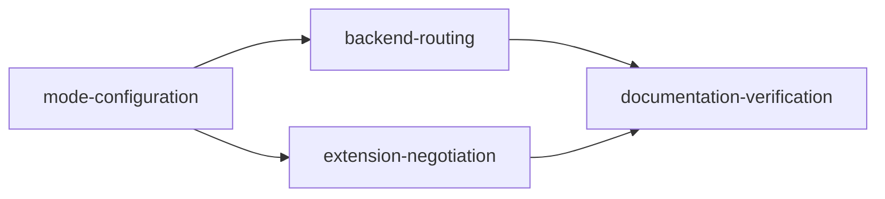

# Organization Sending Modes Implementation Plan

## Goal

Allow organizations using the current browser extension to explicitly select autonomous plugin sending or coordinated multi-node sending. Opening system capability must not silently enroll organizations. Switching must preserve execution ownership, ambiguous outcomes, and quota settlement.

## Architecture Design

The existing layered TypeScript/Nest API and Prisma/PostgreSQL storage remain in place. `SendModeService` owns mode interpretation, Settings row locks, switch safety checks, membership authorization, and mutation receipts. Existing backend producers, coordinators, autonomous claims, and submission authorization consume that service inside their current transactions. The extension negotiates authoritative organization mode before routing, retains its durable controlled execution journal, and offers an administrator-only mode selector and sanitized diagnostics.

Reuse is mandatory: Settings, SendMutationReceipt/SystemSendPolicyMutationReceipt, Serializable `sendTransaction`, `sendHash`/`sendJson`, existing coordinator and permits, existing quota/outcome ledgers, existing plugin journal, and existing autonomous pipeline/backend calls. No new database table or schema migration is required. Existing mutation receipts additionally persist one-shot admission facts for autonomous server-side platform writes; the remote call runs outside retryable transactions, and uncertain results require an audited administrator decision.

## Design Decisions

### High-Impact Decision Record: Public API

1. **Necessity.** GET/POST `/sending/mode` exposes one organization mode with permissions and safe-switch blockers. Typed administrator GET/POST/PUT `/admin/settings/sending.account_bound_enabled` exposes system capability. Expected revision prevents stale safety decisions; request ID makes network retries idempotent. Required expected organization/user IDs bind a mode form to the displayed authenticated owner and reject stale forms after account switches.
2. **Data.** Settings grow by at most one system row and one row per participating organization. Mode reads occur on normal routing and authorization; row locks deliberately serialize configuration with new execution rights. Existing indexed organization predicates count outstanding obligations.
3. **Volatility.** The two selectable modes and paused projection are stable. JSON Settings avoids a schema migration while retaining strict validation of the current contract.
4. **Migration cost.** No database migration or backfill. Missing organization configuration resolves autonomous only without controlled history; existing controlled organizations pause pending explicit administrator enrollment.
5. **Contract.** New endpoints are additive. Existing protocol fields remain, with explicit organization mode fields added. The new extension must not treat missing fields or transport failure as autonomous permission.
6. **Cheaper alternative.** A single environment boolean or automatic fallback would be smaller but cannot support independent organization choice or protect controlled roots during switching.

### High-Impact Decision Record: State Machine

1. **Necessity.** AUTONOMOUS and CONTROLLED are explicit organization choices; PAUSED is an effective state when capability is unavailable or history prevents implicit fallback. Blocker counts explain why a safe switch is unavailable.
2. **Data.** Existing Posts, SendIntents, executions, segments, reservations, and account locks are the authoritative obligations. Terminal history remains immutable; no copied tasks or reset counters are introduced.
3. **Volatility.** Unknown new statuses fail closed through nonterminal-intent checks. Rules live centrally in the mode service rather than being repeated by clients.
4. **Migration cost.** Old autonomous queues and manual Engage drafts must settle before enrollment. Controlled pending roots, active/uncertain work, held quota, and locks must resolve before downgrade. The implementation does not clear or migrate them.
5. **Contract.** A switch affects future independent content only. Existing controlled roots remain protected from autonomous callbacks or retries. System disable stops new authorization while allowing late outcomes and settlement.
6. **Cheaper alternative.** Checking mode outside a transaction is insufficient: a concurrent claim or permit could race a switch. Shared Settings row locks are required.

### High-Impact Decision Record: Extension Protocol

1. **Necessity.** `sendingMode`, `modeRevision`, and `autonomousAllowed` distinguish current-extension autonomous sending from coordinated sending. Options diagnostics expose registration failures without secrets.
2. **Data.** Protocol reads occur with existing polling. Local journal entries remain per execution; no history upload or new identity migration is introduced.
3. **Volatility.** Mode fields are explicit and narrowly typed. Unexpected protocol responses deny routing rather than silently switching.
4. **Migration cost.** Build and reload the current independent extension; no database operation. Old workers and old plugin local autonomous queues must be stopped and settled before rollout.
5. **Contract.** Legacy protocol terminology continues to mean the existing autonomous transport, not an old plugin version. In-flight controlled executions recover through their original outcome path.
6. **Cheaper alternative.** A local-only toggle would not coordinate with backend queues, authorization, or organization members and therefore cannot safely choose sending mode.

## Task Breakdown

- [Mode configuration](tasks/mode-configuration.md): Settings, policy service, typed routes, permission and blocker tests.
- [Backend routing](tasks/backend-routing.md): transaction guards, autonomous/controlled producers and claims, protocol projection.
- [Extension negotiation](tasks/extension-negotiation.md): current-extension mode routing, durable journal recovery, Options controls and diagnostics.
- [Documentation and verification](tasks/documentation-verification.md): implementation-aligned API guides, tests, type checks and builds.

## Risks

- Autonomous manual Engage DRAFT replies can already be submitting in the browser without a server permit; treat unfinished legacy Engage drafts as upgrade blockers.
- Legacy server platform writes, including plugs and thread finishers, require durable pre-call receipts; an empty transaction check cannot protect the subsequent network request. Unknown receipts block switching and automatic resubmission.
- Shared account identity may span projects, so per-project or per-user mode switches are unsafe.
- Memory transaction tests do not prove PostgreSQL SSI/unique-index behavior. Do not claim production concurrency proof without authorized isolated integration testing.
- Frozen `apps/extension/` is excluded. No direct database writes, SQL execution, live platform sends, or migration application are allowed in this task.
- Generic Settings mutation must reject mode keys and organization-mode prefixes to prevent bypassing typed safety rules.

## Acceptance Criteria

- P0: No implicit autonomous downgrade on failed registration, missing mode, malformed Settings, system disable, or uncertain controlled history.
- P0: Switching and creating execution rights serialize on system/organization Settings rows; competing expected revisions have one winner.
- P0: Active execution, authorized/unknown segments, held quota, account locks, nonterminal intents, and pending controlled roots block downgrade.
- P0: Existing controlled roots cannot be resubmitted through autonomous paths; late outcome settlement remains available while paused.
- P0: Receipt replay never reapplies a stale switch or charges quota again; conflicting request bodies are rejected.
- P1: Unenrolled organizations retain autonomous sending, system Settings overrides fallback environment behavior, explicit environment false is an emergency stop.
- P1: Only active organization ADMIN/SUPERADMIN may save mode, and only platform superadmin may save system capability.
- P1: Latest extension Options reflects real backend state and sanitized registration diagnostics.
- P1: Fresh scoped full tests, TypeScript checks, and requested extension builds pass. Record skipped infrastructure cases and the frozen directory exclusion.

## References

- [Product and API specification](../../docs/organization-sending-modes.md)
- [Project instructions](../../AGENTS.md)
- [Mode service](../../libraries/nestjs-libraries/src/extension/send-mode.service.ts)
- [Coordinator](../../libraries/nestjs-libraries/src/extension/send-coordinator.service.ts)
- [Frontend integration](../../../aisee-app/docs/aisee-app-multi-node-integration.md)

